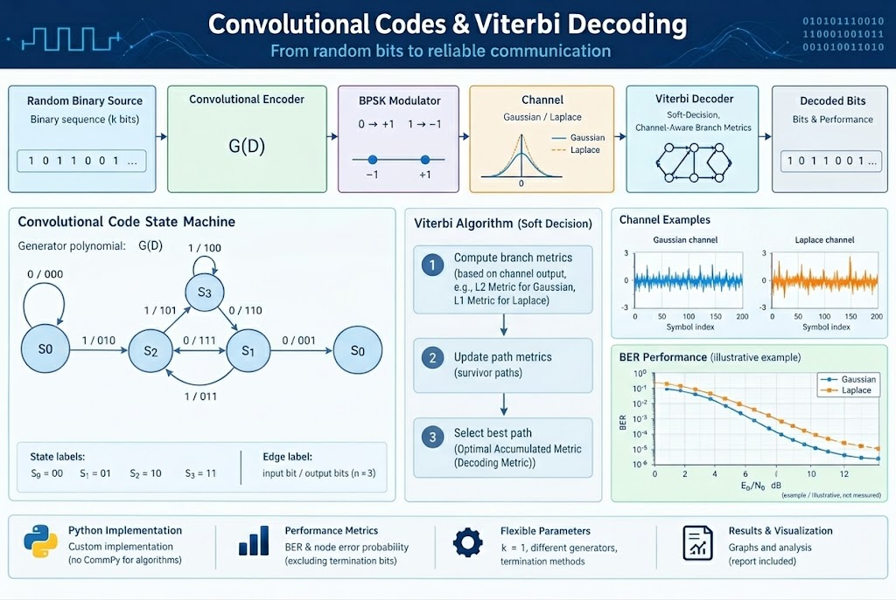

# Convolutional Codes and Viterbi Decoding (October 2026)



## Overview

This project implements and simulates convolutional coding systems in Python, focusing on error correction, Viterbi decoding, and bit error rate (BER) performance evaluation.

The simulation evaluates convolutional coding performance over two noise models: **Additive White Gaussian Noise (AWGN)** and **Laplace noise**.

The project combines algorithm implementation, communication channel modeling, Monte Carlo simulation, and performance analysis.

(Implemented without Generative-AI - to show the "real skills" and coding abillities)

## Key Features

- Convolutional encoding and trellis representation.
- Viterbi decoding for information sequence recovery.
- BPSK modulation and noisy channel simulation.
- Gaussian and Laplace noise models.
- BER performance evaluation as a function of \(E_b/N_0\).
- Simulation result visualization and computational optimization analysis.

## Simulation Results

The project evaluates the BER under different channel conditions and \(E_b/N_0\) values.

Example simulation datasets and visualization scripts are included in the repository to support performance analysis and comparison between the channel models.

The main visualization scripts are:

- `performance_gaussian_graph.py`
- `performance_laplace_graph.py`

## Quick Start

### 1. Install Dependencies

```bash
git clone https://github.com/nivb100/Convolution_Codes.git
cd Convolution_Codes
python -m pip install -r requirements.txt
```

### 2. Run the Simulation

```bash
python conv_code_project.py
```

### 3. Visualize Results

For Gaussian noise:

```bash
python performance_gaussian_graph.py
```

For Laplace noise:

```bash
python performance_laplace_graph.py
```

Before a long run, check the simulation parameters and the input/output paths configured in the scripts.

## Repository Structure

Supporting analysis scripts, images, simulation results, and the project report are organized in the repository.

See [Repository Structure](./docs/repository_structure.md) for a description of the main files and directories.

## Project Report

The full technical report covers the theoretical background, mathematical derivations, algorithm development, simulation methodology, performance graphs, results, and conclusions.

**[Read the Full Project Report (PDF)](./Convolutional_Codes_Project_Report_Hebrew.pdf)**

## Technologies

<p align="left">
  
  
  
</p>

## Documentation

- [Repository Structure Guide](./docs/repository_structure.md) — Directory organization and the purpose of the main project files.
- [Technical Project Report (PDF)](./Convolutional_Codes_Project_Report_Hebrew.pdf) — Detailed theory, implementation, experiments, and conclusions.

## Author

An independent engineering project focused on convolutional error-correction codes, Viterbi decoding, communication channel modeling, and simulation-based performance analysis.
